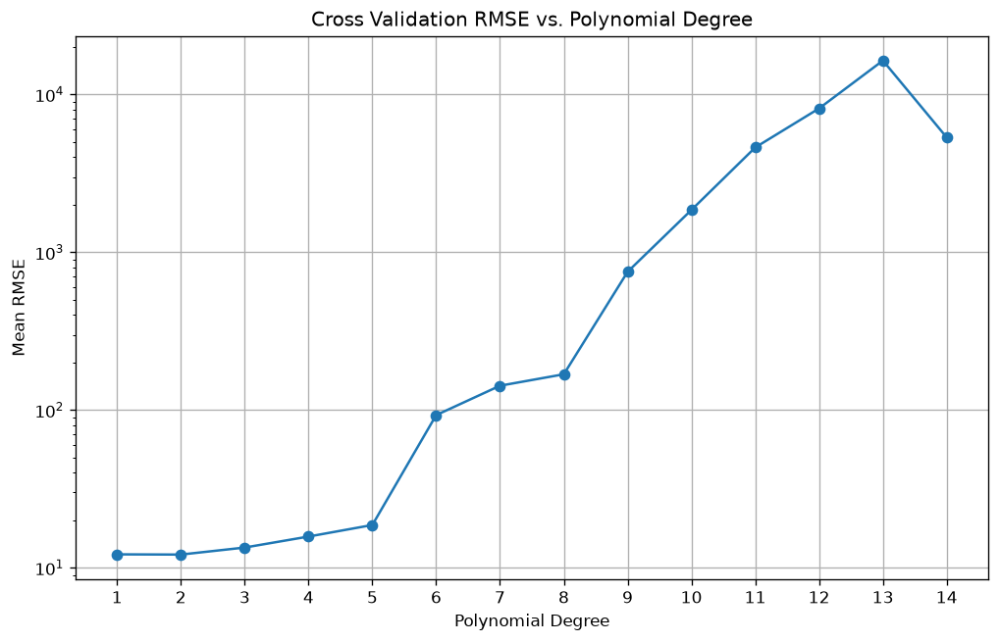

# Blood Pressure Regression

[](https://github.com/yashbagia1708/blood-pressure-regression/actions/workflows/ci.yml)

Predicting systolic blood pressure for 100 patients with three regression
approaches, compared with 10-fold cross-validation:

1. **Polynomial regression on cholesterol alone**, choosing the degree (1 to 14)
   with the lowest cross-validated RMSE
2. **Multiple linear regression** on eight patient features
3. **Ridge regression** on the same eight features (alpha = 0.1)

Built for a university machine learning unit.

## Results

| Model | Features | 10-fold CV RMSE (mmHg) |
|---|---|---|
| Baseline (always predict the mean) | none | 12.7 (std of systolic BP) |
| Polynomial, degree 2 | serum cholesterol | 12.13 |
| Multiple linear regression | 8 features | 8.51 |
| Ridge regression (alpha = 0.1) | 8 features | 8.51 |

**Cholesterol alone barely beats guessing the average.** Its best polynomial
fit gets RMSE 12.13 against a spread of 12.7 in the target. Using all eight
features cuts the error by about a third.

**Higher degrees overfit fast.** Degree 2 is best; past degree 5 the
cross-validated error explodes (into the thousands by degree 10), because a
high-degree curve fitted to 90 points swings wildly on the 10 it hasn't seen:



**Ridge makes no real difference here.** With 8 features and 100 rows the
plain linear model isn't overfitting, so a light penalty leaves the
coefficients almost unchanged.

Strongest linear effects (per unit of each feature, all else equal): age
+0.44 mmHg per year, sodium +0.20, weight +0.13, while more education and more
exercise each come with about 1 mmHg lower. These are associations in a small
sample, not causes.

## Running it

```bash
pip install -r requirements.txt
python regression.py            # prints every result and shows the plot
./tests/check_results.sh        # headless run that checks the headline numbers (CI runs this)
```

## The data

`bloodpressure-23.csv`: 100 rows, one per patient, provided with the
assignment. Columns used: AGE, ED-LEVEL, SMOKING STATUS, EXERCISE, WEIGHT,
SERUM-CHOL, IQ, SODIUM, and the target SYSTOLIC. GENDER, MARITAL-STATUS and
NAME aren't used (the names are placeholders, not real patients).

## Changes since the original submission

The original version built polynomial features from raw cholesterol values
(around 200). At degree 12 that's numbers around 10²⁷, so the fit broke down
numerically: high-degree coefficients came out near 1e-38, the error curve
drifted gently downward, and it reported degree 12 as "best". Cholesterol is
now standardised inside the cross-validation pipeline, which shows the real
picture above. The RMSE plot is also saved to a file. See the pull requests
for detail.
